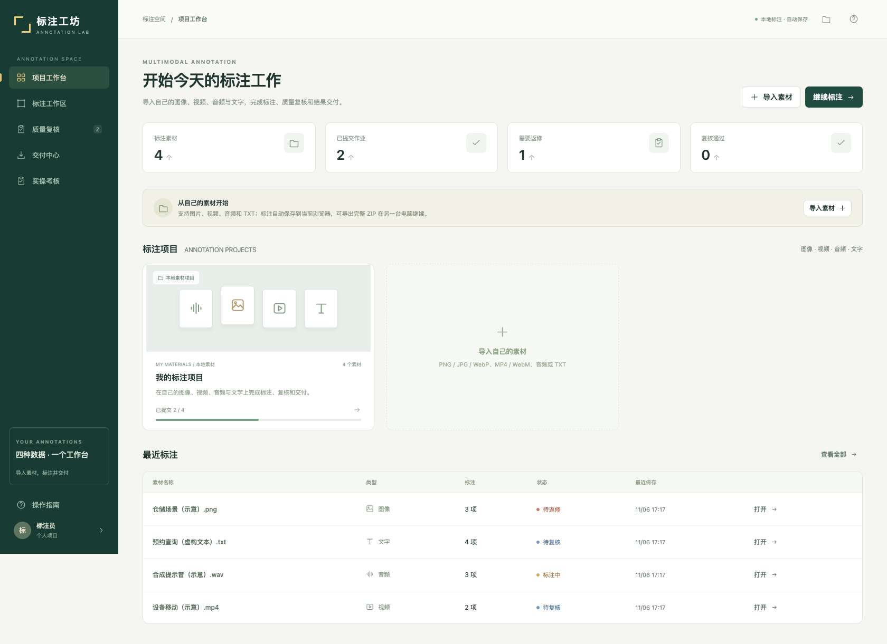
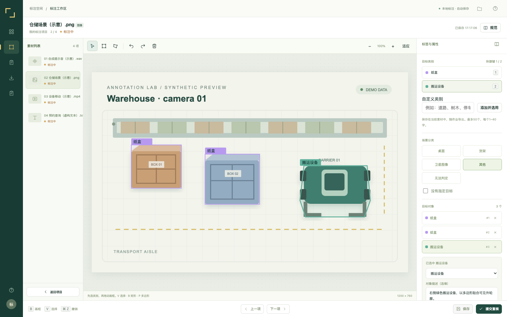
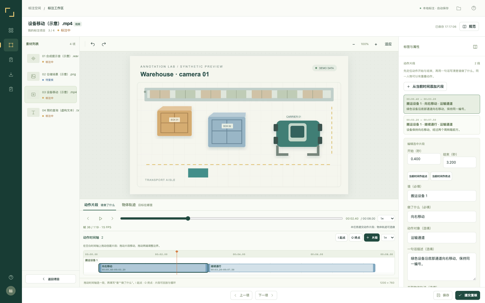
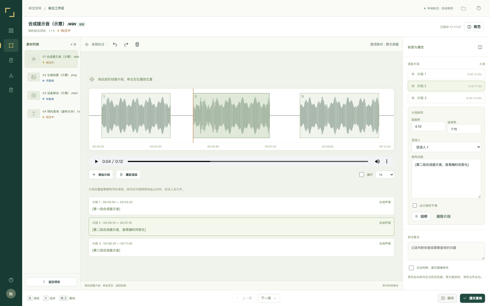
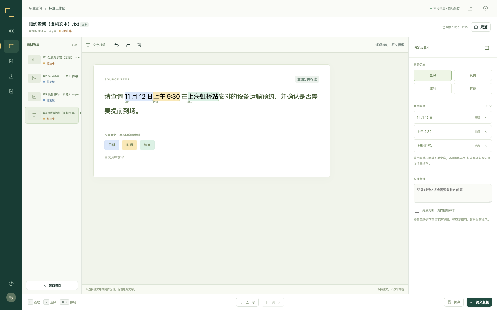
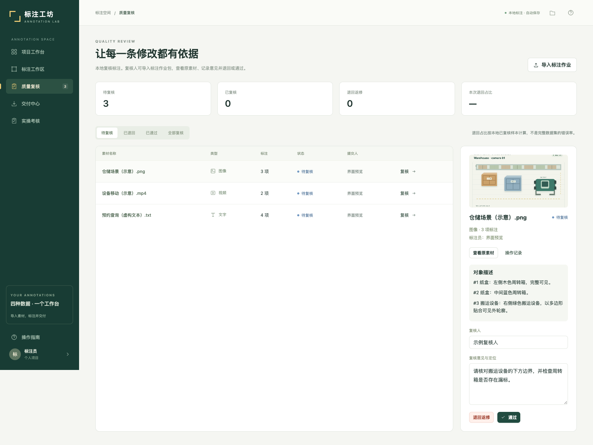

# 標註工坊 · Annotation Lab

支援圖像、影片、音訊與文字的資料標註系統，整合本機自動儲存、品質複核、返修紀錄與多格式交付。使用原生 JavaScript 與瀏覽器 IndexedDB，無須安裝 npm 套件即可執行。

本儲存庫提供 **1.8.0 純系統版**：保留標註工具與考核引擎，不包含課件、教案、課表、內建練習、資料集媒體、模型權重、正式題庫或學員資料。啟動後是空白專案，請匯入自己的素材。

## 系統預覽

以下為實際系統操作截圖，使用臨時產生的示意資料；示意素材不隨儲存庫提供。

### 專案工作台



| 圖像框選與多邊形 | 影片動作時間軸 |
| --- | --- |
|  |  |

| 音訊波形與分段 | 文字意圖與實體 |
| --- | --- |
|  |  |

### 品質複核與返修



## 功能

| 模組 | 功能 |
| --- | --- |
| 圖像 | 場景分類、矩形框、多邊形、移動縮放、自訂類別、遮擋、物件描述、原像素檢視 |
| 影片 | 動作時間軸、人物／動作／對象／描述、重疊片段、逐幀播放、物件軌跡與關鍵幀 |
| 音訊 | 真實解碼波形、片段起止、說話人、轉寫、聽不清標記、選段循環播放 |
| 文字 | 查詢／變更／取消／其他意圖，日期／時間／地點實體區段 |
| 品質複核 | 提交、退回、返修、通過，保留操作與複核歷史 |
| 交付 | 完整 ZIP、JSON、CSV、COCO，以及動作片段 JSON／CSV／SRT／WebVTT |
| 感測器擴充 | 讀取相容作業包中的 Nymeria IMU／TCN 特徵，與影片同步檢視 |
| 實操考核 | 私有題庫、密碼開考、伺服器計時、草稿續答、收卷與答卷匯出 |

影片關鍵幀之間採線性插值。IMU／TCN 模組是配套資料檢視器，需要自行準備相容資料，系統不附模型或訓練資料。

## 快速啟動

需要 **Node.js 20+**：

```sh
git clone https://github.com/Chang-Poyen/annotation-lab.git
cd annotation-lab
npm start
```

開啟 [http://localhost:4173](http://localhost:4173)。無須執行 `npm install` 或建置。

macOS 可雙擊 `启动平台.command`，Windows 可雙擊 `启动平台.bat`。也可使用 Python 3.9+ 標準庫啟動：

```sh
python3 serve-python.py
```

自訂連接埠：macOS／Linux 使用 `PORT=4180 npm start`；Windows 命令提示字元先執行 `set PORT=4180`，再執行 `npm start`。前端使用 ES modules，請透過伺服器開啟，勿直接開啟 HTML 檔。

## 使用流程

1. 按「匯入素材」，選擇圖片、影片、音訊或 TXT。
2. 在標註工作區完成標註，修改會自動儲存。
3. 按「提交複核」，在品質複核頁檢查並記錄意見。
4. 退回後可修改再提交；已提交或通過的項目可先撤回編輯。
5. 在交付中心匯出結果。跨電腦移交時使用**包含原始素材的完整 ZIP**，接收端再匯入作業包。

素材與標註保存在目前瀏覽器的 IndexedDB，各瀏覽器與站點的資料獨立。更換電腦或清除網站資料前，請先匯出 ZIP 備份。一般標註工作區不提供多帳號後端或自動同步；考核模式另由伺服器保存答卷。

## 匯入與匯出

- 素材：PNG、JPG、WebP、MP4、WebM、瀏覽器可解碼的音訊、TXT；每次最多 100 個檔案，單檔上限 100 MB。
- 作業包：本系統產生的未壓縮 ZIP，單包上限 250 MB，包含素材、標註與複核歷史。
- JSON：結構化標註，不附媒體；自己的圖片或影片請使用完整 ZIP 移交。
- CSV：目標框、關鍵幀、動作片段、音訊轉寫、文字實體與描述。
- COCO：圖像像素座標、類別、多邊形與面積；物件描述保存在擴充屬性。
- 動作包：JSON、CSV、SRT 與 WebVTT，不附影片。

文字區段採 UTF-16 索引，結束位置不包含在區段內。影片軌跡需設定真實固定幀率，動作片段使用秒。

## 可選：設定實操考核

考核引擎使用 Python 3.9+ 與 SQLite，無須第三方套件。題庫、密碼雜湊、媒體與答卷資料庫應放在 `dist/` 之外的私有目錄，透過 `ANNOTATION_EXAM_HOME` 指定。

設定方式與檔案格式見 [考核設定](docs/exam-setup.md)。未設定題庫時，普通標註功能仍可使用，考核入口顯示尚未設定。

## 專案結構

```text
dist/                 原生 HTML、CSS、JavaScript，可直接提供靜態服務
  app.js              導覽、匯入、複核與交付流程
  editor.js           圖像、影片、音訊與文字標註器
  video-actions.js    動作時間軸介面
  core.js             資料模型、標籤、校驗與關鍵幀
  io.js               ZIP、JSON、CSV、COCO 與字幕
  storage.js          IndexedDB 與本機媒體
  nymeria-sensors.js  配套 IMU／TCN 資料檢視
  exam.*             考核前端
server.mjs            Node.js 啟動入口與靜態伺服器
serve-python.py       Python 伺服器、影片範圍請求與考核 API
exam_service.py       私有題庫、計時、答卷儲存與匯出
tests/                核心邏輯與考核 HTTP 回歸測試
docs/images/          README 系統預覽圖
```

`dist/` 內是維護用的程式原始碼，本專案沒有編譯步驟。`.gitignore` 排除本機媒體、課程素材、私有題庫、憑證及答卷資料。

## 驗證

```sh
npm test
npm run test:exam
```

測試涵蓋幾何操作、自訂類別、關鍵幀、動作時間邊界、資料校驗、ZIP 媒體往返、匯出格式、描述保留、感測器資料及考核權限與計時。GitHub Actions 會執行相同檢查。

## Contributors

| 貢獻者 | 角色 |
| --- | --- |
| [Poyen Chang / Chang-Poyen](https://github.com/Chang-Poyen) | 專案發起、需求、標註流程與驗收 |
| [Codex（OpenAI）](https://openai.com/codex/) | AI 協作：系統整理、程式調整、驗證、預覽圖與文件；本次提交附共同作者署名 |

標註工坊採用自己的品牌與實作。操作流程參考 [CVAT](https://docs.cvat.ai/docs/annotation/annotation-editor/) 與 [Label Studio](https://labelstud.io/tags/timelinelabels) 的公開文件。
